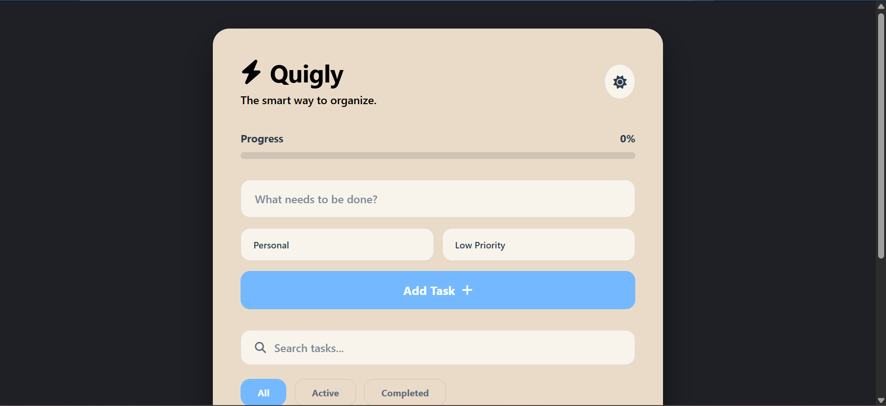
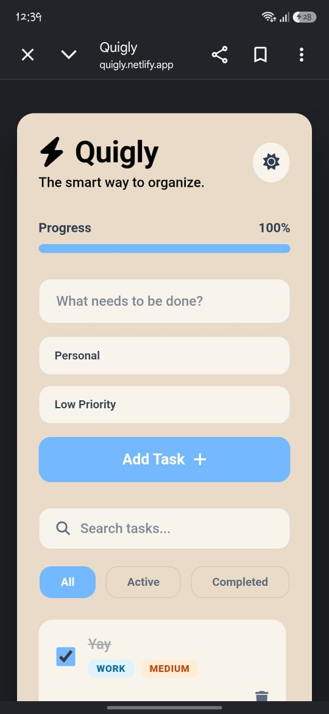

# Quigly | Smart Task Manager

Quigly is a lightweight, high-performance task management application built with Vanilla JavaScript. It focuses on clean state management, data persistence, and a premium user interface. This is the foundational build for a larger AI-integrated vision.

## Live Demo
[View Live App](quigly.netlify.app)

## Screenshots

### Desktop View

### Mobile View

## Features

### Core Features
- CRUD Operations: Add, delete, and mark tasks as complete.
- Filtering: Filter tasks by All, Active, and Completed.
- Task Counter: Real-time counter showing tasks left.
- Data Persistence: Uses `localStorage` so tasks survive a browser refresh.
- Form Validation: Prevents users from adding empty tasks.
- Clear Completed: Bulk delete completed tasks with one click.

### Extra Features (For Higher Grade)
- Priority & Categories: Assign tags (Work, Study, Personal) and priority levels (High, Medium, Low) with color-coded UI.
- Real-time Search: Instantly filter tasks by keyword with a dynamic "Empty State" message.
- Progress Bar: Calculates the percentage of completed tasks visually.
- Theme Toggle: Custom Beige/Blue color palette with Dark/Light mode toggle using CSS variables.
- Custom SVG Preloader: A line-drawing animation on initial page load.
- Responsive Layout: Adapts gracefully to small screens.

## 🛠️ Tech Stack
- HTML5
- CSS3 (CSS Variables, Flexbox, Grid, SVG Animation)
- Vanilla JavaScript (ES6+, Array Methods)
- FontAwesome (Icons)

## 🚀 Setup & Installation
To run this project locally:
1. Clone the repository: `git clone https://github.com/Tripple-svg/quigly.git`
2. Navigate to the project folder.
3. Open `index.html` in your web browser.

## 🧠 What I Learned & Challenges
- The Flexbox Footer Bug: I encountered a layout bug where adding copyright text using a ` ` tag caused elements to jumble together. I fixed this by refactoring the HTML structure and changing the parent footer container to `flex-direction: column`, keeping the copyright cleanly separated below the main controls.
- State Management: Learned how to effectively manage state in Vanilla JS by using a single `tasks` array, filtering it for the UI, and serializing it with `JSON.stringify` for local storage.